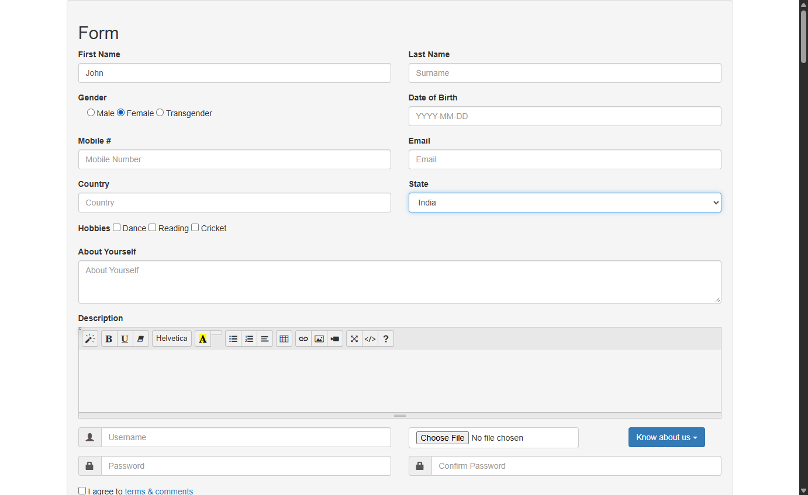

# CloudQA robust form automation (Task 1)

C# + Selenium program that fills **First Name** (text box), **Gender** (radio button) and **State**
(dropdown) on <https://app.cloudqa.io/home/AutomationPracticeForm>, and keeps working when the page
changes: fields reordered, `id`/`name`/`class` renamed, HTML restructured, or similar-looking fields added.

No field is found with a fixed XPath or CSS selector. Fields are found by **what they mean to a person**:
their label, nearby text, position on screen and options. See **[APPROACH.md](APPROACH.md)** for the
approach and its limitations.

Author: Lakshya Jain ([@lakshya1333](https://github.com/lakshya1333))



## Setup

1. Install the **.NET 8 SDK**: <https://dotnet.microsoft.com/download/dotnet/8.0>
   (check with `dotnet --list-sdks`).
2. Install **Google Chrome** (Edge and Firefox also work). The browser driver is downloaded automatically
   by Selenium Manager; nothing else to install.
3. Clone the repository:

   ```bash
   git clone https://github.com/lakshya1333/CloudQA-robust-form-automation.git
   cd CloudQA-robust-form-automation
   ```

## Run

```bash
dotnet run                                          # live CloudQA page, values from appsettings.json
dotnet run -- --url https://your-host/modified-page  # any other version of the page
dotnet run -- --url C:\pages\variant.html            # local HTML files work too
dotnet run -- --suite TestPages --headless           # all 13 bundled variants with a pass/fail summary
dotnet run -- --gender Male --state Japan --first-name Asha --browser edge
```

**Windows one-click:** double-click `check-and-run.bat`. It builds the project, runs the 13 variant
pages and then the live page, and writes the output to `build-and-test-log.txt`. If no .NET 8 SDK is
found it installs one portably into `D:\dotnet`.

### Options

| Option | Meaning | Default |
|---|---|---|
| `--url <url or file>` | Page to test (also `CLOUDQA_URL` env var or `Url` in appsettings.json) | live CloudQA page |
| `--suite <folder>` | Run every `.html` page in a folder | – |
| `--browser chrome\|edge\|firefox` | Browser to use | chrome |
| `--headless` | No visible browser window | off |
| `--timeout <seconds>` | How long to keep looking for the fields | 15 |
| `--first-name`, `--gender`, `--state` | Values to enter | John, Female, India |
| `--no-iframes`, `--no-shadow-dom` | Turn off searching inside iframes / Shadow DOM | on |
| `--min-score <n>` | Confidence needed to accept a field | 0.45 |
| `--report-dir <folder>` | Where JSON reports and screenshots go | Reports |
| `--config <file>` | Use another settings file | appsettings.json |

Exit codes: `0` all passed, `1` a field failed, `2` bad configuration, `3` browser could not start.

## Output

Each run prints what it found and why, saves a screenshot, and writes a JSON report to `Reports/`:

```
Page   : https://app.cloudqa.io/home/AutomationPracticeForm
Form   : <form id="automationtestform" class="well">  (top page)
PASS firstName  type "John"
        element : <input type="text" id="fname" name="First Name" ...>  [confidence 1.30]
        because : label "First Name" +1.00; nearby-text "First Name" +0.85; visual-label "First Name" +0.75; ...
        result  : read back "John"
PASS gender     choose "Female"
        because : nearby-text "Gender" +0.85; visual-label "Gender" +0.75; 3 options look like gender values +0.45
        result  : option "Female" is selected
PASS state      select "India"
        because : label "State" +1.00; nearby-text "State" +0.85; ...; contains option "India" +0.20
        result  : selected option is "India"
Result : PASS
```

## Verified

5 Nov 2026, Windows, Chrome 156, .NET SDK 8.0.427: build 0 warnings / 0 errors, **13/13 variant pages
passed**, live CloudQA page passed. Full log: [docs/sample-run-log.txt](docs/sample-run-log.txt).

## Test pages (`TestPages/`)

| Page | What changed |
|---|---|
| 01-original | Replica of the live page, including the Shadow DOM duplicate form and hidden modal |
| 02-reordered | State first, Gender second, Last Name before First Name |
| 03-renamed-attributes | Every id/name/class meaningless, labels without `for` |
| 04-table-layout | Labels and inputs in separate table cells |
| 05-grid-separate-labels | Labels in another container; only screen position links them |
| 06-custom-widgets | Fieldset/legend, visually hidden radios behind styled labels, floating label, label-wrapped select |
| 07-look-alike-decoys | Newsletter form first, Father's First Name, Nickname, Shipping State, Marital-status radios |
| 08-aria-and-placeholder-only | No visible labels at all |
| 09-inside-iframe | Whole form inside an iframe |
| 10-dynamic-random | Injected after 2 s, random order and random ids on every load |
| 11-div-soup-no-form | No `<form>`, upper-case labels with `*`/`:`, "Sex:" instead of Gender, option text before radios |
| 12-shadow-dom-only | Form inside a custom element's shadow root |
| 13-original-mutated-with-decoy | Live page with every id/for/name/class/placeholder stripped and fields moved; Shadow DOM duplicate left in place |

Each page marks the real field with `data-expect="…"`. The locator never reads it; `--suite` mode checks
it afterwards to prove the correct element was used, not just *an* element.

## Project layout

```
Program.cs                     entry point: runs page(s), stale-element retry, data-expect check
appsettings.json               URL, browser, test data, keyword lists
Config/                        settings model + loader (json → env vars → command line)
Locator/SmartLocator.js        in-page scoring engine (embedded in the exe)
Locator/SmartFormLocator.cs    waiting, iframe search, result parsing
Actions/FieldActions.cs        type / click / select with fallbacks + read-back verification
Infrastructure/                browser driver factory, console + JSON report
TestPages/                     13 modified versions of the form
check-and-run.bat              Windows one-click build + test
APPROACH.md                    approach and limitations
```
